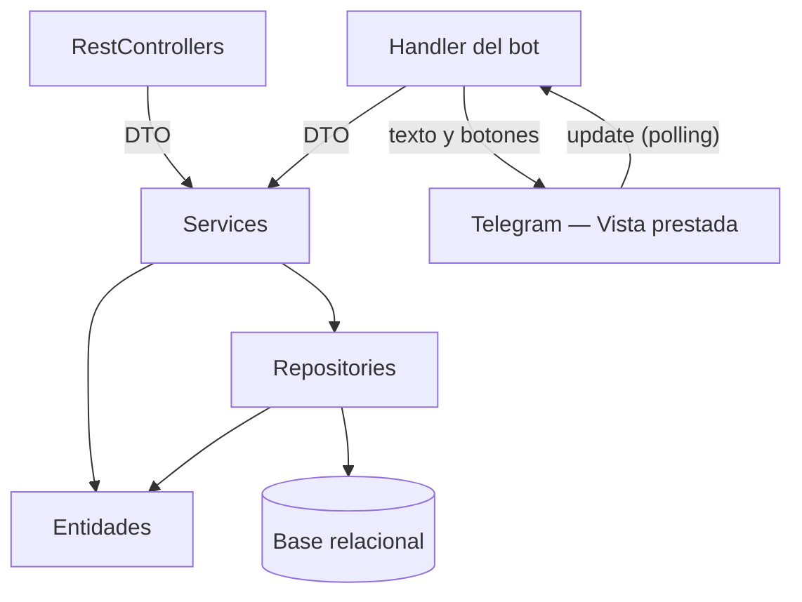
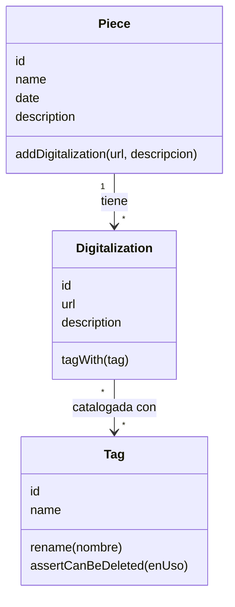
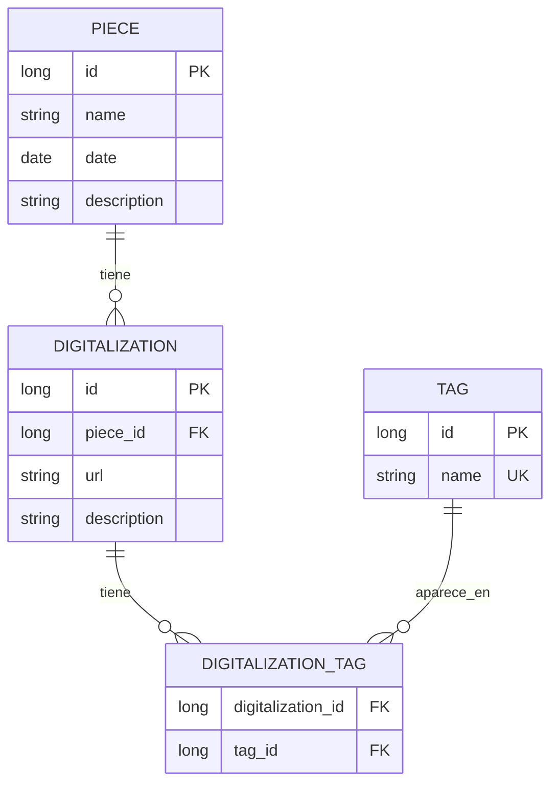
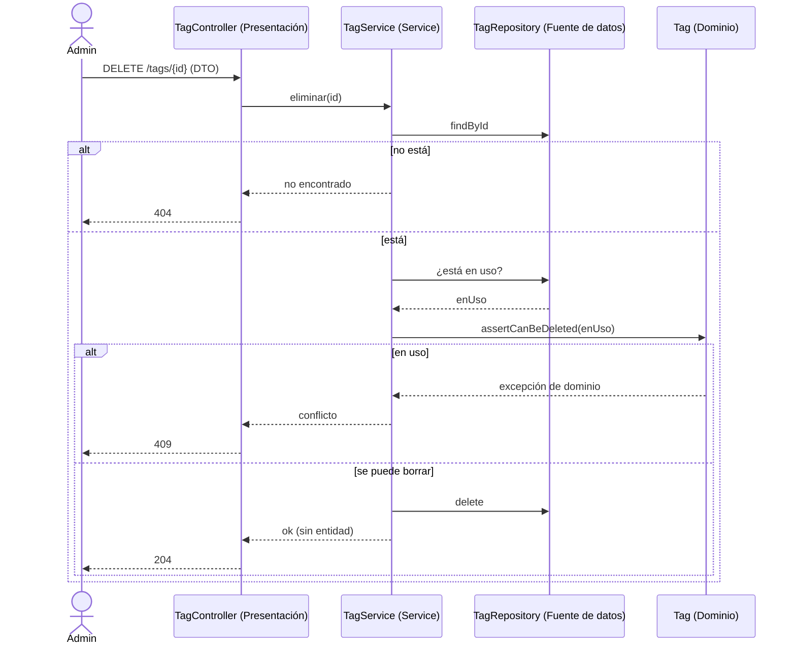

# ARCHITECTURE.md

Documento transversal del TP Archivo Digital. Complementa a `AGENTS.md`.
Decisiones del grupo (23/11/2026, con correcciones de revisión). Integrantes: Nico, Demian, Gaby y Lucas. Nombre del grupo: a definir.

## 1. Descripción general

Monolito Spring Boot (Java 21, una sola base) que digitaliza material físico, lo cataloga con tags administrables y permite buscar **piezas**. Digitalización, Catalogación y Disponibilización son APIs (sin pantallas). La única cara de usuario es un bot de Telegram.

Actores: el **administrador** mantiene el conjunto de tags (la API de tags es la de administración; no hay autenticación). El **operador** da de alta piezas, digitalizaciones y catalogación por API. El **consultante** busca en Telegram. Telegram es la Vista prestada: dibuja el chat; el Handler decide qué mostrar.

## 2. Alcance y fuera de alcance

**Dentro:** alta de pieza (fecha de **carga**) y digitalizaciones (URL válida + descripción); tags sobre digitalizaciones, conjunto editable en runtime, sin tag «sin tag», no borrar un tag en uso (409), sí renombrar (por id), nombre único; búsqueda de **piezas** en el Repository (filtro, `DISTINCT`, paginación); bot en long polling (`/buscar texto`, `/tag nombre`, «ver más»), token en variable de entorno, webhook solo con el extra de Render; README y `/docs/` (diagramas, `api.md`, `test.md`).

**Fuera:** pantallas; autenticación; repetir ISW1 (salvo que el grupo se lo banque); Clean Architecture como estructura; extras (Render + Postgres, OCR, batch CSV).

## 3. Capas de Fowler

Cuatro capas de Introducción: Presentación → Service → Dominio, más Fuente de datos. El Service orquesta y **traduce DTO ↔ dominio**, sin reglas propias. No se saltean capas. Spring solo pone `@RestController`, `@Service`, `@Entity` y `Repository`.



| Capa | En este TP | Qué no hace |
|---|---|---|
| **Presentación** | `@RestController` y `TelegramSearchHandler`. Reciben y devuelven **solo DTOs**, nunca entidades. | Reglas de negocio. No habla con el Repository. No hay pantallas. |
| **Service** | Casos de uso, transacción (todo-o-nada) y traducción DTO ↔ dominio. *Orquesta, pero no decide.* Recurso inexistente → 404. | No concentra invariantes (si lo hace, el dominio queda anémico). No expone entidades hacia afuera. |
| **Dominio** | `Piece`, `Digitalization`, `Tag` con comportamiento e invariantes. | No sabe si lo llamó el bot o la API. No arma SQL ni habla con Telegram. No resuelve el 404. |
| **Fuente de datos** | Repositories: SQL/JPA, filtros, `DISTINCT`, paginación, «¿el tag está en uso?». | No decide reglas de negocio. |

## 4. Paquetes

Por capa, bajo `ar.edu.unsam.ddso.tp` (`AGENTS.md`: código en inglés, docs en español).

```
controller/   # Presentación: RestControllers y Handler (vale un subpaquete telegram)
dto/          # records de request/response; jamás se expone la entidad
service/      # Service (traduce DTO ↔ dominio)
model/        # Dominio: @Entity, métodos de negocio, excepciones de invariantes
repository/   # Fuente de datos (interfaz + impl JPA y, si sirve, en memoria)
exception/    # 404 / infraestructura + @RestControllerAdvice (400, 404, 409)
```

Clases tentativas: `Piece`, `Digitalization`, `Tag`; `PieceService`, `DigitalizationService`, `TagService`, `SearchService`; controllers equivalentes y `TelegramSearchHandler`. Tests de Service: JUnit 5 + Mockito, sin Spring, repositorio mockeado (`Given` / `When` / `Then`).

## 5. Dominio (sin modelo anémico)



Comportamiento en las entidades (no en el Service): `piece.addDigitalization(url, descripcion)` (URL válida, descripción obligatoria); `digitalization.tagWith(tag)` (sin duplicar); `tag.rename(nombre)` (no vacío); `tag.assertCanBeDeleted(enUso)` (si está en uso, excepción de dominio). También: nombre de pieza obligatorio; nombre de tag único.

Si hace falta un dato de la base (¿está en uso? ¿el nombre ya existe?), el Service **pregunta al Repository y se lo pasa a la entidad**. «Pieza o tag inexistente» no es regla de dominio: el Service responde **404**.

`Piece.date` es la fecha de carga. Decisión tomada para implementar. Nota para el foro: ¿La fecha de la pieza es la de carga o la del material físico?

## 6. Base de datos



## 7. Flujos

El Handler y el `SearchController` llaman al mismo `SearchService`, siempre con DTOs. En local, long polling.

Criterios: rango `from`/`to` sobre la fecha de carga; nombre y descripción con *contains* case-insensitive; la descripción se busca en la pieza **y** en sus digitalizaciones; tags combinados con **AND**; el Repository filtra, usa `DISTINCT` y pagina.

```mermaid
sequenceDiagram
    actor Consultante
    participant Telegram as Telegram (Vista, Presentación)
    participant Handler as TelegramSearchHandler (Presentación)
    participant Service as SearchService (Service)
    participant Repo as Repository (Fuente de datos)
    participant DB as Base

    Consultante->>Telegram: /buscar texto o /tag nombre
    Telegram->>Handler: update (long polling)
    Handler->>Service: SearchRequestDTO
    Note right of Handler: solo DTOs; no habla con el Repository
    Service->>Repo: filtro + DISTINCT + página
    Repo->>DB: SQL / JPA
    DB-->>Repo: filas
    Repo-->>Service: entidades Piece
    Service-->>Handler: lista de PieceResponseDTO
    Handler->>Telegram: resultados y botón «ver más»
    Telegram-->>Consultante: los dibuja en el chat
```

Borrar un tag en uso:



La recorrida feliz de `test.md`: crear un tag, crear una pieza, crear una digitalización, catalogarla y buscarla (por API y por el bot).

## 8. Decisiones

| Decisión | Por qué |
|---|---|
| Monolito, H2 en local | Lo pide la consigna. Postgres + Render es extra. |
| Cuatro capas de Fowler de Introducción | Consigna + acuerdo del 09/11/2026. Clean Architecture queda como teoría comparativa. |
| Presentación y bot solo DTOs; el Service traduce DTO ↔ dominio | Clase de Introducción. El Controller/Handler nunca reciben ni devuelven entidades. |
| Comportamiento en las entidades (`addDigitalization`, `tagWith`, `rename`, `assertCanBeDeleted`) | Evitar el dominio anémico (Introducción + `AGENTS.md`). |
| Tag en uso: el Service pregunta al Repository y llama `assertCanBeDeleted(enUso)` → 409; inexistente → 404 | La invariante es de dominio; el «no está» es orquestación. Mismo patrón si el nombre del tag está repetido. |
| Fecha de carga; búsqueda con rango, *contains*, descripción en pieza y digitalizaciones, tags con AND, `DISTINCT` + paginación | Acuerdo del 23/11/2026, para implementar. La consigna pide asumir muchas piezas. Nota al foro: confirmar si la fecha debía ser la del material físico. |
| Long polling; `/buscar`, `/tag` y «ver más»; token en variable de entorno | Demo local sin URL pública. Webhook solo con el extra de Render. |
| Autenticación fuera de alcance | La consigna no pide login. |
| Tests unitarios de Service con Mockito, sin Spring | Lo pide la consigna y es el estilo de la clase de testing. |

## 9. Preguntas abiertas

- Nombre del grupo (va en el README).
- Quién toma cada rol A/B/C/D (ver `Backlog.md`). Si el rol D queda cargado, el Handler puede pasarse a otra persona.

## 10. Referencias

- Consigna del TP Integrador (caso Archivo Digital).
- [`AGENTS.md`](AGENTS.md), [`api.md`](api.md) y template https://github.com/ddso-unsam/tp-repo-template
- Presentaciones DDSO: Introducción (Fowler, Service, DTO ↔ dominio, dominio anémico), Spring Boot, Interfaz de Usuario (Vista prestada), Clean Architecture (comparativa), Testing unitario.
